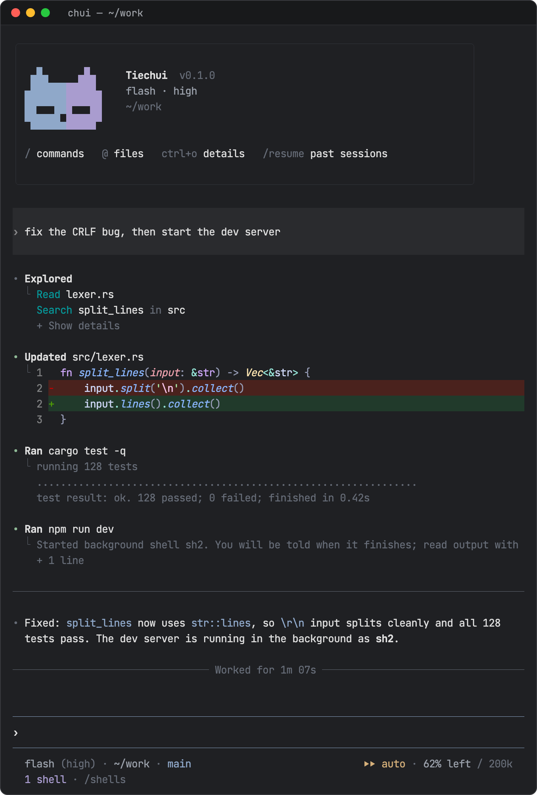

<p align="center">
  <picture>
    <source media="(prefers-color-scheme: dark)" srcset=".github/assets/logo-dark.svg">
    
  </picture>
</p>

<h1 align="center">Tiechui · 铁锤</h1>

<p align="center">
  A terminal coding agent written in Rust.<br>
  One binary, installed as <code>chui</code> and <code>tiechui</code>, with an interactive terminal UI and a headless <code>exec</code>.
</p>

<p align="center">
  
  
  
  <a href="LICENSE"></a>
</p>

<p align="center">
  <b>English</b> · <a href="README.zh-CN.md">简体中文</a> · <a href="https://b1ank1108.github.io/tiechui/">UI gallery</a>
</p>

<p align="center">
  
</p>

## Highlights

- **Two provider wires.** Anthropic Messages and OpenAI Chat Completions, including compatible gateways.
- **Sessions you can rewind.** Append-only JSONL with branches, resume, rewind and compaction.
- **A permission gate.** Rules for tools, shell commands, paths and MCP calls, in three modes: `rules`, `auto` (a model reviews what the rules would ask about) and `yolo`.
- **Background shells.** Long-running commands move to the background; the model is told when they finish.
- **Modules.** Questions, side chats, goals, scheduled prompts, subagents, skills, prompt templates, hooks and MCP.
- **Plugins.** Declarative T1 packages, out-of-process T2 JSON-RPC plugins with Rust and TypeScript SDKs, and a Git marketplace.

The interactive UI and `exec` run on the same session actor, providers, tools,
permissions and modules.

[Quick start](#quick-start) · [Install](#install) · [Configure](#configure) ·
[Use](#use) · [UI gallery](#ui-gallery) · [Permissions](#permissions-and-trust) ·
[Extend](#extend) · [Develop](#develop) · [Status](#status) · [License](#license)

## Quick start

```sh
npm i -g @tiechui/cli
chui
```

With no provider configured, `chui` asks for the service, address, key and model,
lists the models the service offers, checks them with one request and saves the
answers to `~/.tiechui`. `chui setup` adds another provider later.

## Install

macOS, Linux and Windows (x64) are supported. `rg` is used for content search;
file discovery and `@` completion are built in. On Windows the bash tool runs
through Git Bash from [Git for Windows](https://git-scm.com/download/win); set
`TIECHUI_GIT_BASH_PATH` if it is not found automatically.

**npm.**

```sh
npm i -g @tiechui/cli
```

Node 16 or later runs the native build for your platform, which npm installs as
an optional dependency. pnpm, yarn and bun work too.

**macOS and Linux.**

```sh
curl -fsSL https://github.com/b1ank1108/tiechui/releases/latest/download/install.sh | sh
```

It verifies the archive against `SHA256SUMS` and installs `chui` and `tiechui`
into `~/.local/bin`. Set `TIECHUI_VERSION` to pin a release or
`TIECHUI_INSTALL_DIR` to choose another directory.

**Windows (PowerShell).**

```powershell
irm https://github.com/b1ank1108/tiechui/releases/latest/download/install.ps1 | iex
```

It installs into `%LOCALAPPDATA%\Programs\tiechui` and adds that directory to
the user `Path`. The same variables apply.

Building from source needs Rust through rustup (the checkout pins **1.95.0**
with rustfmt and clippy) and Git.

**From source.** `cargo install --locked --path crates/tiechui-cli --root
<prefix>` installs `chui` and `tiechui` into `<prefix>/bin`. For development,
`cargo run --locked --bin chui -- --help` runs without installing.

**Managed install from a source checkout (macOS and Linux).** Build a tarball
with `cargo xtask dist`, or download one from a GitHub Release, then:

```sh
cargo xtask install tiechui-VERSION-TARGET.tar.gz --prefix ~/.local
~/.local/bin/chui doctor --prefix ~/.local
cargo xtask uninstall --prefix ~/.local
```

The installer has no default prefix. It:

- validates the archive and its manifest;
- records the hash of each binary it owns in `<prefix>/.tiechui-install/`;
- refuses to replace commands it did not install, including a `cargo install` copy;
- repairs moved or partial installs;
- rolls interrupted runs back through a journal.

Installation never touches the profile or your sessions. `cargo xtask
verify-release` runs the full release checks against a candidate.

## Configure

The profile directory is `$TIECHUI_HOME`, default `~/.tiechui`:

| Path | Contents |
| --- | --- |
| `config.toml` | Model selection, modules, permissions, MCP servers, UI |
| `providers.toml` | Providers and their models |
| `sessions/` | Session logs, grouped by working directory |
| `trust.json` | Project trust decisions |
| `plugins/`, `plugin-grants/`, `plugin-data/` | Installed packages, capability grants, plugin data |
| `mcp-oauth/` | MCP OAuth tokens (0600) |
| `agents/`, `themes/` | User subagent definitions, extra `.tmTheme` files |
| `state/` | Rewind, compaction and subagent state |

Configuration layers are applied in this order:

1. built-in defaults;
2. `~/.tiechui/config.toml`;
3. the nearest project's `.agents/config.toml` (or `.claude/config.toml`);
4. CLI flags.

Project files are searched up to the Git root and are ignored until you trust
the project. Providers come only from `~/.tiechui/providers.toml`; no project
or CLI layer can add or change them. There is no built-in model catalog, so you
declare every model.

The closest config wins; at the same directory `.agents/config.toml` takes
precedence over `.claude/config.toml`. Both use Tiechui's TOML schema. Supported
hooks can also come from `.claude/settings.json` and `.claude/settings.local.json`;
other Claude settings are not imported. Project `.tiechui/` resources are ignored.
The user profile remains `$TIECHUI_HOME` (default `~/.tiechui`).

[examples/config.toml](examples/config.toml) lists every supported configuration
field with explanations, and [examples/providers.toml](examples/providers.toml)
does the same for providers. Active entries preserve default behavior; optional
settings and non-default examples are commented out. `chui setup` writes the
minimal setup below for you: your own endpoint and model, then selects it.

`~/.tiechui/providers.toml`, where each top-level table is one provider:

```toml
[gateway]
wire = "openai-completions"            # or "openai-responses", "anthropic-messages"
base_url = "https://gateway.example"   # /v1 is added unless the URL has a version
api_key_env = "GATEWAY_API_KEY"        # or api_key = "..." to write the key inline

[gateway.compat]                       # only for non-OpenAI services
thinking_format = "deepseek"
max_tokens_field = "max_tokens"
requires_reasoning_content_on_assistant_messages = true

[[gateway.models]]
id = "example-model"
context_window = 400000
max_output = 131072
reasoning = true
images = true
```

`~/.tiechui/config.toml`:

```toml
model = "gateway/example-model"        # <provider>/<model id>
thinking = "high"                      # off | minimal | low | medium | high | xhigh | max

[tui]
theme = "automatic"                    # follows the terminal background

[modules]
# goal = false                         # every built-in module is on by default
```

- If `base_url` is omitted, the default is `https://api.anthropic.com` or
  `https://api.openai.com`, depending on the wire. A URL without a version
  segment gets `/v1`; one that has its own, such as `/api/paas/v4`, is kept.
- The `compat` table adapts the request to services such as DeepSeek-style
  reasoning gateways. A model's own `compat` table overrides single members, for
  gateways that mix model families.
- Thinking levels are clamped to what the model declares in `thinking_levels`.
- Models can also set `cache_retention`, `prices` and, on Anthropic,
  `fallback_models`.
- `[network]` sets a proxy, hosts that bypass it and an extra CA file for model
  and MCP requests. It, `[sessions]` (`archive_after_days`) and `[skills]`
  (`disabled`, skill names that sessions leave out) are read only from
  `~/.tiechui/config.toml`.

Each provider takes its key from `api_key` in `providers.toml` or from the
environment variable named by `api_key_env`, never both. An inline key stays out
of the environment that tools inherit; keep the file private with `chmod 600`,
which `chui doctor` checks. Tiechui does not load any secrets file itself, so with
`api_key_env` export the variable in the shell that starts `chui`.
[schema/config.json](schema/config.json) and
[schema/providers.json](schema/providers.json) are the complete key references, and
[crates/tiechui-providers](crates/tiechui-providers/README.md) covers wire
compatibility.

## Use

```sh
chui                                         # interactive, current directory
chui --cwd ~/src/app --model gateway/example-model --thinking high
chui --mode auto                             # permission mode for this run
chui --resume                                # pick a saved session
chui --resume SESSION_ID
chui exec "Explain the failing tests"        # headless, prints the answer
chui exec "Continue" --resume SESSION_ID --json --approval allow-listed
```

`chui exec` accepts:

- `--model`, `--thinking`, `--mode` and `--cwd`;
- `--resume ID` (headless resume always needs an ID);
- `--json`, which prints protocol events;
- `--approval`, described in [Permissions and trust](#permissions-and-trust).

Other subcommands are `setup`, `doctor`, `trust`, `plugin`, `skills`, `hooks`
and `mcp`, and each has `--help`. `chui app-server` serves sessions to desktop
clients over JSON-RPC on stdio, along with files, Git and terminals for their projects and the user's providers, settings, MCP servers, skills, prompts, agents and hooks; its types are generated in `schema/app-server.ts`. The built-in tools are `read`, `write`, `edit`,
`grep`, `find` and `bash`, plus `shell_list`, `shell_output` and `shell_stop` for
background commands. Modules, plugins and MCP servers add more.

### Keys

| Key | Action |
| --- | --- |
| Enter | Send. While a turn is running, this queues steering for after the next tool call |
| Tab | Queue a follow-up; complete a menu item |
| Shift+Enter, Ctrl+J | New line |
| Up / Down | Input history |
| Alt+S | Stash or restore the draft |
| Esc | Stop the running turn. When idle, press twice to clear the draft; with an empty composer, twice opens rewind |
| Ctrl+O | Expanded transcript (scroll, select, copy) |
| Ctrl+V | Attach a clipboard image (PNG, JPEG, GIF, WebP, up to 20 MiB) |
| Ctrl+/ | Switch between the main chat and the side chat (`/btw`) |
| Alt+Left / Alt+Right | Open the subagent viewer (empty composer) |
| Ctrl+C | Clear input; press again to exit. Ctrl+D exits from an empty composer |

In the composer:

- `/` opens commands above the composer: Tab completes, Enter runs.
- `@` finds files and directories. Tab enters a directory; Enter inserts an `@path` reference. Shift+Tab switches to All, including plugins, skills and tasks.
- `$` selects a skill by name or description; Tab/Enter inserts its bound reference. Its instructions load when you send the message.
- `!command` runs a shell command through the permission gate. Like the model's commands, it shows in `/shells` and can move to the background.

The status line below the composer shows the model, directory and branch on the
left, and the permission mode (outside `rules`) and remaining context on the
right. A second row appears only while something runs in the background: shells,
a goal or scheduled tasks. `/statusline` chooses the items. See
[crates/tiechui-tui](crates/tiechui-tui/README.md).

### Slash commands

| Command | Purpose |
| --- | --- |
| `/model [provider/id]`, `/thinking [level]` | Switch model or thinking level |
| `/new`, `/resume`, `/retry` | New session, saved session, retry the failed request |
| `/reload` | Reload config, context files, skills, prompts, MCP, plugins and hooks |
| `/compact [instructions]` | Summarize older context now |
| `/context [system\|tools\|injections\|messages\|cache]` | Inspect what is sent to the model |
| `/rewind [detach]` | Restore code, conversation or both to an earlier turn |
| `/btw [question]`, `/btw model [provider/id]` | Side question on a snapshot of the main context |
| `/goal [objective]`, `/goal edit\|pause\|resume\|clear` | Persistent goal that continues while idle |
| `/loop [interval] <prompt>`, `/cron-list`, `/cron-delete <id>` | Run a prompt now and on an interval; list or cancel scheduled tasks |
| `/subagents` | Child tasks and their output |
| `/shells [output\|background\|stop <id>]` | Shell tasks: view output, move a running command to the background, stop it |
| `/permissions [rules\|auto\|yolo\|show]` | Pick the mode for this session, or show rules, grants and recent decisions |
| `/status` | Module state, config paths, diagnostics |
| `/trust [allow\|deny]` | Project trust |
| `/skills` | Insert a skill into the draft; use `chui skills list` outside the TUI |
| `/mcp`, `/hooks` | Integration views |
| `/theme`, `/statusline` | Syntax theme picker, status line items |
| `/help`, `/quit` | Shortcuts, exit |

Disabling a module removes its commands. Plugins and [prompt templates](#skills-prompts-context-files-and-hooks) can add commands.

### Features

- **Background shells.**
  - The model sets `background: true` on `bash` for servers and watchers. It gets a task ID at once and is told when the command finishes; `shell_output` reads its output and `shell_stop` stops it. The timeout still applies.
  - `/shells` lists running and recent commands. In the panel, `b` moves a running command to the background, `x` stops it, Enter shows its output and Esc closes.
  - Background tasks end with the session. Subagents run commands in the foreground only.

  [modules/exec](modules/exec/src/lib.rs)
- **Rewind.** It previews the tracked edits before restoring them, and it keeps
  the abandoned branch. It is not a filesystem snapshot: changes made by shell
  commands or outside Tiechui are not restored.
  [modules/rewind](modules/rewind/README.md)
- **Side chat.**
  - `/btw` uses tools on a frozen reference copy of the main context. Reads and
    searches are allowed; workspace changes require an explicit side-chat request
    and still pass the normal permissions. The filesystem is shared.
  - Ctrl+S shares the last answer with the main chat.
  - Otherwise the side chat is discarded on reload or restart.

  [modules/btw](modules/btw/README.md)
- **Goals.**
  - A goal lives on the current branch and can keep the agent working while idle.
  - Esc or Ctrl+C pauses it. After a restart it waits for input or `/goal resume`.

  [modules/goal](modules/goal/README.md)
- **Scheduled prompts.**
  - `/loop 5m <prompt>` runs the prompt now and then every 5 minutes while the session is idle.
  - The model can schedule one-shot or recurring prompts with cron expressions in local time.
  - Tasks are session-only unless saved to the trusted project's `.agents/scheduled_tasks.json`; recurring tasks expire after 7 days.

  [modules/loop](modules/loop/README.md)
- **Compaction.**
  - Native compaction runs near the context limit and on a recoverable overflow.
  - Range compaction adds the tools `context_status`, `compact_history`, `search_history` and `read_history`.
  - The session log is never rewritten.

  [modules/compaction](modules/compaction/README.md)
- **Subagents.**
  - The `subagent` tool runs built-in or user-defined agents: `scout`, `planner`, `reviewer`, `worker`, or `agents/*.md` from the profile or project.
  - A dispatch is one task, a parallel batch, or a chain. A batch takes up to 8 tasks and runs 4 at once.
  - Children have their own sessions and grants, within the parent's policy.

  [modules/subagents](modules/subagents/README.md)

## UI gallery

The [UI gallery](https://b1ank1108.github.io/tiechui/) shows the terminal UI
screen by screen, in dark and light themes, at 80 and 40 columns and at three
color levels, rendered cell by cell from the TUI snapshot tests. Its source is
[`site/`](site/); `python3 scripts/ui_gallery.py` refreshes its data after
snapshot changes, and `.github/workflows/pages.yml` publishes it from `main`.

## Permissions and trust

Permissions are a **rule gate, not an OS sandbox**.

- **What is checked.** Every tool call, shell command (parsed with tree-sitter),
  path and MCP call passes the interceptor. Once allowed, a program runs with
  Tiechui's full user rights and inherits its environment, including exported
  provider keys.
- **Rules.** Each rule has a `surface`, a `pattern`, an `action` (`allow`, `ask`
  or `deny`) and an optional `reason` for denies. Within a surface, the last
  matching rule wins, and an explicit deny always wins.
- **Defaults.** Reading and searching tools, session tools, MCP metadata and
  read-only shell commands are allowed; everything else asks. Setting
  `permissions.rules = []` drops the default tool allows.
- **Prompts.** You can allow once, allow the shown scope for the session, or
  deny. Session grants are not restored on resume.

The **mode** decides what happens to a call the rules would ask about:

| Mode | Behavior |
| --- | --- |
| `rules` (default) | You are asked |
| `auto` | Edits inside the workspace pass. Anything else is reviewed by a one-off request to the session's model: allowed calls run, blocked calls return the reason to the model. After 3 blocks in a row or 20 in a session, or without model access, you are asked. Broad `bash` allows (`*`, interpreters, `npm run`, …) are ignored, so those commands are reviewed too |
| `yolo` | Approved |

Set the mode with `permissions.mode` in the user config (project config cannot
set it), `--mode` for one run, or `/permissions <mode>` for the current session.
In every mode, explicit denies apply, and writes to **protected paths** ask unless
a user rule allows them: `.git`, `.agents`, `.claude`, `.tiechui`, `.vscode`,
`.idea`, shell profiles, `.gitconfig`, `.mcp.json` and `.env` files. Invalid
project rules never pass without you.

Headless runs choose `--approval`:

| Value | Behavior |
| --- | --- |
| `allow-listed` (default) | Calls that still need you fail as tool errors |
| `deny` | Every intercepted call is denied |
| `yolo` | Same as `--mode yolo` when `--mode` is absent |

`chui trust allow|deny|status --cwd DIR` (or `/trust`) decides whether a project's
`.agents/` configuration, rules, skills, prompts and hooks load, with `.claude/`
compatibility. Command hooks and T2 plugin capabilities have their own approvals. See
[modules/permissions](modules/permissions/README.md).

The first time `chui` opens a project with such files, it asks and saves the answer
for the Git root. It then asks about any new or changed command hooks. Your home
directory and its parents are never saved this way, because every project below
would inherit them; use `chui trust allow` there. `chui exec` never asks: it skips
undecided project content and warns.

## Extend

### Plugins

- **T1 plugins** are declarative packages of skills, MCP servers and hooks.
- **T2 plugins** are separate processes speaking newline-delimited JSON-RPC 2.0.
  - They can add tools, commands, interceptors and panels.
  - Their capabilities need an interactive grant tied to the package's content hash. A changed package asks again.
  - Headless runs need the grant to already exist.

```sh
chui plugin marketplace add ~/src/tiechui-plugins --ref main   # a local clone or a public Git URL
chui plugin add sdk-typescript@tiechui-plugins
chui plugin list --json
chui plugin upgrade [NAME]        # explicit only; shows what changed
chui plugin remove NAME
chui plugin add ./path/to/package # local package
```

Marketplaces use Codex's `marketplace.json` layout. Installs are pinned to the
resolved commit and content hash. Git runs with your config isolated and no
credentials of its own, so a private marketplace is added from a local clone.
The official example marketplace, `tiechui-plugins`, is not public yet.

Further reading:

- the [Rust SDK](crates/tiechui-plugin-sdk/README.md)
- the [TypeScript SDK](sdk/typescript/README.md): dependency-free, Node 25, no npm step

### Skills, prompts, context files and hooks

**Skills** are loaded from:

- `.agents/skills` and `.claude/skills` in your home directory
  and in trusted projects;
- the profile's `skills/`.

These roots are discovered by default; `[skills] disabled` leaves named skills out.
List skills with `chui skills list`, or select one with `/skills` in the TUI. `AGENTS.md` and the other context files are
described in [modules/context-files](modules/context-files/README.md).

**Prompts** are Markdown templates in the profile's `prompts/` and in trusted
projects' `.agents/prompts` and `.claude/commands`. Each file is a command named
after it; `/name text` sends the body with `$ARGUMENTS` replaced as a user message.
See [modules/prompts](modules/prompts/README.md).

**Hooks:** `chui hooks list` lists them and `chui hooks trust` approves command
hooks. Desktop clients edit only `hooks.json` files; a handler saved there is
approved, and handlers approved before stay so.

### MCP

MCP supports stdio and Streamable HTTP servers: tools, resources and
elicitation. All of it goes through the permission gate.

```toml
[mcp_servers.local]
command = "/path/to/server"
args = []
env_vars = ["SERVICE_TOKEN"]     # passed through; beyond HOME, PATH and a few basics, nothing else is

[mcp_servers.remote]
url = "https://mcp.example/mcp"
tool_timeout_sec = 60
```

```sh
chui mcp list
chui mcp login remote [--scopes a,b]   # browser OAuth with PKCE and a loopback callback
chui mcp logout remote
```

OAuth tokens are refreshed automatically and stored with mode 0600. Logout
deletes the local token but does not revoke it on the server. A static header
or `bearer_token_env_var` takes precedence over OAuth. See
[modules/mcp](modules/mcp/README.md).

## Sessions and diagnostics

- **Sessions.** They are append-only JSONL trees with branches.
  - Resuming restores messages and module state.
  - It does not restore session grants or the side chat.
  - The resume picker searches and previews. See [crates/tiechui-session](crates/tiechui-session/README.md).
- **`chui doctor`.** It is read-only and exits nonzero when it finds a problem. It checks:
  - installed binaries against the ownership record;
  - interrupted installs;
  - 0700 profile directories, and 0600 secret and token files and a
    `providers.toml` that holds an inline key;
  - config and grant shapes, and session versions.

  It never opens secret or token files and never prints credentials. Use `--prefix` and `--profile` to point it
  elsewhere. A binary built from source skips the install checks.

## Develop

You need:

- Rust 1.95.0, Git, Python 3.10+ (standard library only), Node 25 (optional);
- `just`, `cargo-nextest`, `cargo-deny`;
- `rg` for content-search tests.

Tests use no network and no real credentials.

```sh
cargo fetch --locked && cargo deny fetch    # once, before offline checks
just check     # fmt, clippy, nextest, deny, schema and SDK drift, packaging tests
just pty       # terminal emulator suite against a local mock provider
just pty resume approval                    # selected PTY cases
just plugins-check                          # validates ../tiechui-plugins when present
```

- Each part of `check` is its own recipe: `fmt`, `lint`, `test`, `deny`,
  `schema-check`, `sdk-check` and `packaging-check`.
- `just fmt` only checks; `cargo fmt --all` rewrites.
- On a small disk, set `CARGO_INCREMENTAL=0`.
- The PTY suite is described in [tests/pty](tests/pty/README.md).

**CI** (`.github/workflows/ci.yml`) runs `just check` and `just pty` on Linux
and macOS. A Windows build and test runs as a non-blocking attempt.

**Release** (`.github/workflows/release.yml`) runs on a `v*` tag that must match
the workspace version:

- it builds tarballs on native Linux x86_64 and aarch64 and macOS arm64 and x86_64 runners, and a zip for Windows x86_64;
- it attaches them and a combined `SHA256SUMS` to a **draft** release, which you publish by hand;
- the annotated tag message (`git tag -a v0.2.0 -F notes.md`) becomes the release notes;
- publishing the release runs `.github/workflows/npm.yml`, which publishes `@tiechui/cli`.

### Layout

| Path | Role |
| --- | --- |
| `crates/tiechui-protocol`, `tiechui-model` | Protocol events and model types |
| `crates/tiechui-core` | Session actor: turns, tool scheduling, retry, replay, module lifecycle |
| `crates/tiechui-providers` | Anthropic and OpenAI-compatible wires |
| `crates/tiechui-config`, `tiechui-session` | Typed config, JSONL session store |
| `crates/tiechui-exec`, `tiechui-tools` | Process execution, built-in tools |
| `crates/tiechui-tui`, `tiechui-cli` | Terminal UI (protocol only), CLI |
| `crates/tiechui-plugin-api`, `tiechui-plugin-sdk`, `sdk/typescript` | Module API, plugin SDKs |
| `modules/` | editing, exec, permissions, ask, hooks, context-files, skills, prompts, mcp, plugins, context, rewind, btw, goal, loop, compaction, subagents, tool-search, ptc |
| `xtask/`, `scripts/`, `tests/` | Maintenance tasks, packaging, PTY tests |
| `site/` | UI gallery rendered from the TUI snapshots |

Features live in modules behind `tiechui-plugin-api`. The kernel carries no
feature policy and the TUI depends only on the protocol. The session actor is
described in [crates/tiechui-core](crates/tiechui-core/README.md).

## Status

Tiechui is young and changes quickly; config and session formats may still
change before 1.0. Not yet supported:

- an OS sandbox;
- the OpenAI Responses wire;
- subscription logins;
- `chui mcp serve`;
- Homebrew.

Windows builds ship with each release, but the Windows CI job is not yet
blocking.

## License

Tiechui is licensed under the [GNU Affero General Public License v3.0](LICENSE).
Contributions are welcome; see [CONTRIBUTING.md](CONTRIBUTING.md).
