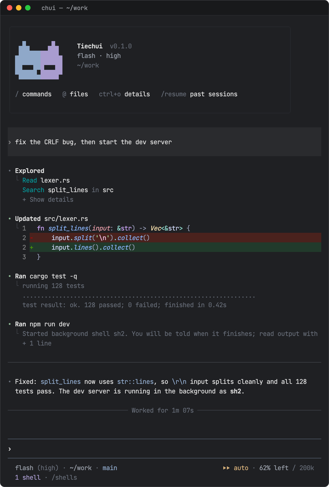

<p align="center">
  <picture>
    <source media="(prefers-color-scheme: dark)" srcset=".github/assets/logo-dark.svg">
    
  </picture>
</p>

<h1 align="center">铁锤 · Tiechui</h1>

<p align="center">
  用 Rust 写的终端编程代理。<br>
  一个二进制，以 <code>chui</code> 和 <code>tiechui</code> 两个名字安装，提供交互式终端界面和无界面的 <code>exec</code>。
</p>

<p align="center">
  
  
  
  <a href="LICENSE"></a>
</p>

<p align="center">
  <a href="README.md">English</a> · <b>简体中文</b> · <a href="https://b1ank1108.github.io/tiechui/">界面一览</a>
</p>

<p align="center">
  
</p>

## 亮点

- **两种 provider 协议。** Anthropic Messages 与 OpenAI Chat Completions，含兼容网关。
- **可回退的会话。** 追加写入的 JSONL，支持分支、恢复、回退和压缩。
- **权限闸门。** 对工具、shell 命令、路径和 MCP 调用的规则，分三种模式：`rules`、`auto`（由模型审查规则本会询问的调用）和 `yolo`。
- **后台 shell。** 长时间运行的命令可转入后台，结束时通知模型。
- **模块。** 提问、旁聊、目标、定时提示、子代理、技能、hooks 和 MCP。
- **插件。** 声明式 T1 包；进程外 T2 JSON-RPC 插件，附 Rust 与 TypeScript SDK；以及 Git 市场。

交互界面和 `exec` 共用同一个会话 actor、provider、工具、权限和模块。

[快速开始](#快速开始) · [安装](#安装) · [配置](#配置) · [使用](#使用) ·
[界面一览](#界面一览) · [权限](#权限与信任) · [扩展](#扩展) · [开发](#开发) ·
[状态](#状态) · [许可证](#许可证)

## 快速开始

```sh
npm i -g @tiechui/cli
chui
```

还没有配置 provider 时，`chui` 会依次询问服务、地址、密钥和模型，列出服务提供的模型，
用一次请求验证后把结果存进 `~/.tiechui`。之后用 `chui setup` 添加更多 provider。

## 安装

支持 macOS、Linux 和 Windows (x64)。内容搜索使用 `rg`；文件发现和 `@` 补全是内置的。
Windows 上 bash 工具通过 [Git for Windows](https://git-scm.com/download/win) 的
Git Bash 运行；自动找不到时设置 `TIECHUI_GIT_BASH_PATH`。

**npm。**

```sh
npm i -g @tiechui/cli
```

Node 16 及以上运行对应平台的原生构建，由 npm 作为可选依赖安装。pnpm、yarn 和 bun 同样可用。

**macOS 和 Linux。**

```sh
curl -fsSL https://github.com/b1ank1108/tiechui/releases/latest/download/install.sh | sh
```

它用 `SHA256SUMS` 校验压缩包，把 `chui` 和 `tiechui` 装进 `~/.local/bin`。
设置 `TIECHUI_VERSION` 可固定版本，`TIECHUI_INSTALL_DIR` 可换安装目录。

**Windows (PowerShell)。**

```powershell
irm https://github.com/b1ank1108/tiechui/releases/latest/download/install.ps1 | iex
```

它装到 `%LOCALAPPDATA%\Programs\tiechui` 并把该目录加入用户 `Path`，同样的变量适用。

从源码构建需要通过 rustup 安装的 Rust（仓库固定 **1.95.0**，含 rustfmt 和 clippy）和 Git。

**从源码安装。** `cargo install --locked --path crates/tiechui-cli --root <prefix>`
会把 `chui` 和 `tiechui` 装进 `<prefix>/bin`。开发时用
`cargo run --locked --bin chui -- --help` 免安装运行。

**从源码仓库托管安装（macOS 和 Linux）。** 用 `cargo xtask dist` 构建 tarball，
或从 GitHub Release 下载，然后：

```sh
cargo xtask install tiechui-VERSION-TARGET.tar.gz --prefix ~/.local
~/.local/bin/chui doctor --prefix ~/.local
cargo xtask uninstall --prefix ~/.local
```

安装器没有默认 prefix。它会：

- 校验压缩包及其清单；
- 在 `<prefix>/.tiechui-install/` 记录自己拥有的每个二进制的哈希；
- 拒绝替换不是它安装的命令，包括 `cargo install` 装的副本；
- 修复被移动或不完整的安装；
- 通过日志回滚中断的安装。

安装从不触碰 profile 或会话。`cargo xtask verify-release` 对候选版本跑完整的发布检查。

## 配置

profile 目录是 `$TIECHUI_HOME`，默认 `~/.tiechui`：

| 路径 | 内容 |
| --- | --- |
| `config.toml` | 模型选择、模块、权限、MCP 服务器、界面 |
| `providers.toml` | provider 及其模型 |
| `sessions/` | 会话日志，按工作目录分组 |
| `trust.json` | 项目信任决定 |
| `plugins/`、`plugin-grants/`、`plugin-data/` | 已安装的包、能力授权、插件数据 |
| `mcp-oauth/` | MCP OAuth 令牌（0600） |
| `agents/`、`themes/` | 用户子代理定义、额外的 `.tmTheme` 文件 |
| `state/` | 回退、压缩和子代理状态 |

配置层按以下顺序应用：

1. 内置默认值；
2. `~/.tiechui/config.toml`；
3. 最近项目的 `.agents/config.toml`（或 `.claude/config.toml`）；
4. CLI 参数。

项目文件向上查找到 Git 根目录，在你信任项目之前会被忽略。provider 只来自
`~/.tiechui/providers.toml`，项目层和 CLI 层都不能添加或修改。没有内置模型目录，
每个模型都要自己声明。

最近的配置优先；同一目录下 `.agents/config.toml` 优先于 `.claude/config.toml`，
两者都使用 Tiechui 的 TOML schema。支持的 hooks 也可以来自 `.claude/settings.json`
和 `.claude/settings.local.json`；其他 Claude 设置不会导入。项目里的 `.tiechui/`
资源会被忽略。用户 profile 始终是 `$TIECHUI_HOME`（默认 `~/.tiechui`）。

[examples/config.toml](examples/config.toml) 列出了所有支持的配置字段及说明，
[examples/providers.toml](examples/providers.toml) 对 provider 做了同样的事。
未注释的条目保持默认行为；可选设置和非默认示例都被注释掉了。`chui setup` 会替你写出
下面的最小配置：声明你自己的端点和模型，然后选中它。

`~/.tiechui/providers.toml`，每个顶层表是一个 provider：

```toml
[gateway]
wire = "openai-completions"            # 或 "openai-responses"、"anthropic-messages"
base_url = "https://gateway.example"   # 没有版本段时自动补 /v1
api_key_env = "GATEWAY_API_KEY"        # 或 api_key = "..." 直接写入密钥

[gateway.compat]                       # 仅用于非 OpenAI 服务
thinking_format = "deepseek"
max_tokens_field = "max_tokens"
requires_reasoning_content_on_assistant_messages = true

[[gateway.models]]
id = "example-model"
context_window = 400000
max_output = 131072
reasoning = true
images = true
```

`~/.tiechui/config.toml`：

```toml
model = "gateway/example-model"        # <provider>/<model id>
thinking = "high"                      # off | minimal | low | medium | high | xhigh | max

[tui]
theme = "automatic"                    # 跟随终端背景

[modules]
# goal = false                         # 所有内置模块默认开启
```

- 省略 `base_url` 时，按协议默认为 `https://api.anthropic.com` 或
  `https://api.openai.com`。地址里没有版本段时自动补 `/v1`；自带版本段的（如
  `/api/paas/v4`）原样使用。
- `compat` 表让请求适配 DeepSeek 风格推理网关等服务。模型自己的 `compat` 表可以
  覆盖单个字段，适用于混合多个模型家族的网关。
- 思考级别会被限制在模型 `thinking_levels` 声明的范围内。`openai-responses` 关闭思考时发送
  effort `none`；不支持它的模型可把 `off` 映射为 `"minimal"` 或标记为 `false`。
- 模型还可以设置 `cache_retention`、`prices`，Anthropic 上还有 `fallback_models`。

每个 provider 的密钥来自 `providers.toml` 里的 `api_key`，或 `api_key_env` 指定的
环境变量，二者不能同时使用。直接写入的密钥不会进入工具继承的环境；用 `chmod 600`
保护该文件，`chui doctor` 会检查。Tiechui 自己不加载任何密钥文件，所以使用
`api_key_env` 时要在启动 `chui` 的 shell 里导出变量。
[schema/config.json](schema/config.json) 和 [schema/providers.json](schema/providers.json)
是完整的键参考，[crates/tiechui-providers](crates/tiechui-providers/README.md)
介绍协议兼容性。

## 使用

```sh
chui                                         # 交互模式，当前目录
chui --cwd ~/src/app --model gateway/example-model --thinking high
chui --mode auto                             # 本次运行的权限模式
chui --resume                                # 选择已保存的会话
chui --resume SESSION_ID
chui exec "Explain the failing tests"        # 无界面运行，打印回答
chui exec "Continue" --resume SESSION_ID --json --approval allow-listed
```

`chui exec` 接受：

- `--model`、`--thinking`、`--mode` 和 `--cwd`；
- `--resume ID`（无界面恢复必须给 ID）；
- `--json`，打印协议事件；
- `--approval`，见[权限与信任](#权限与信任)。

其他子命令有 `setup`、`doctor`、`trust`、`plugin`、`skills`、`hooks` 和 `mcp`，都支持 `--help`。
`chui app-server` 通过 stdio 上的 JSON-RPC 向桌面客户端提供会话及其项目的文件、Git 与终端，以及用户的供应商、设置与 MCP 服务器，类型生成在 `schema/app-server.ts`。
内置工具是 `read`、`write`、`edit`、`grep`、`find` 和 `bash`，以及管理后台命令的
`shell_list`、`shell_output` 和 `shell_stop`。模块、插件和 MCP 服务器会添加更多工具。

### 按键

| 按键 | 动作 |
| --- | --- |
| Enter | 发送。回合运行中时，排队一条引导，在下一次工具调用后送达 |
| Tab | 排队一条后续消息；补全菜单项 |
| Shift+Enter、Ctrl+J | 换行 |
| Up / Down | 输入历史 |
| Alt+S | 暂存或恢复草稿 |
| Esc | 停止运行中的回合。空闲时按两次清空草稿；输入框为空时按两次打开回退 |
| Ctrl+O | 展开的对话记录（滚动、选择、复制） |
| Ctrl+V | 附加剪贴板图片（PNG、JPEG、GIF、WebP，最大 20 MiB） |
| Ctrl+/ | 在主对话和旁聊（`/btw`）之间切换 |
| Alt+Left / Alt+Right | 打开子代理查看器（输入框为空时） |
| Ctrl+C | 清空输入；再按一次退出。输入框为空时 Ctrl+D 退出 |

在输入框中：

- `/` 在输入框上方打开命令：Tab 补全，Enter 执行。
- `@` 查找文件和目录。Tab 进入目录；Enter 插入 `@path` 引用。Shift+Tab 切到 All，包含插件、技能和任务。
- `$` 按名称或描述选择技能；Tab/Enter 插入绑定的引用。发送消息时才加载技能说明。
- `!command` 经过权限闸门运行 shell 命令。和模型的命令一样，它会出现在 `/shells` 里，也可以转入后台。

输入框下方的状态行左侧显示模型、目录和分支，右侧显示权限模式（非 `rules` 时）和
剩余上下文。只有后台有东西在运行时（shell、目标或定时任务）才会出现第二行。
`/statusline` 选择显示项。见 [crates/tiechui-tui](crates/tiechui-tui/README.md)。

### 斜杠命令

| 命令 | 用途 |
| --- | --- |
| `/model [provider/id]`、`/thinking [level]` | 切换模型或思考级别 |
| `/new`、`/resume`、`/retry` | 新会话、已保存的会话、重试失败的请求 |
| `/reload` | 重新加载配置、上下文文件、技能、MCP、插件和 hooks |
| `/compact [instructions]` | 立即总结较早的上下文 |
| `/context [system\|tools\|injections\|messages\|cache]` | 查看发送给模型的内容 |
| `/rewind [detach]` | 把代码、对话或两者恢复到更早的回合 |
| `/btw [question]`、`/btw model [provider/id]` | 基于主上下文快照的旁路提问 |
| `/goal [objective]`、`/goal edit\|pause\|resume\|clear` | 空闲时继续推进的持久目标 |
| `/loop [interval] <prompt>`、`/cron-list`、`/cron-delete <id>` | 立即并按间隔运行提示；列出或取消定时任务 |
| `/subagents` | 子任务及其输出 |
| `/shells [output\|background\|stop <id>]` | shell 任务：查看输出、把运行中的命令转入后台、停止 |
| `/permissions [rules\|auto\|yolo\|show]` | 选择本会话的模式，或查看规则、授权和最近的决定 |
| `/status` | 模块状态、配置路径、诊断 |
| `/trust [allow\|deny]` | 项目信任 |
| `/skills` | 把技能插入草稿；界面外用 `chui skills list` |
| `/mcp`、`/hooks` | 集成视图 |
| `/theme`、`/statusline` | 语法主题选择器、状态行显示项 |
| `/help`、`/quit` | 快捷键、退出 |

禁用模块会移除它的命令。插件可以添加命令。

### 功能

- **后台 shell。**
  - 模型对服务器、监听器等命令给 `bash` 设置 `background: true`，立即拿到任务 ID，命令结束时会收到通知；`shell_output` 读取输出，`shell_stop` 停止。超时仍然生效。
  - `/shells` 列出运行中和最近的命令。面板里 `b` 把运行中的命令转入后台，`x` 停止，Enter 查看输出，Esc 关闭。
  - 后台任务随会话结束。子代理只能在前台运行命令。

  [modules/exec](modules/exec/src/lib.rs)
- **回退。** 恢复前预览被追踪的编辑，并保留被放弃的分支。它不是文件系统快照：
  shell 命令或 Tiechui 之外做的修改不会被恢复。
  [modules/rewind](modules/rewind/README.md)
- **旁聊。**
  - `/btw` 在主上下文的冻结参考副本上使用工具。读取和搜索是允许的；修改工作区需要
    旁聊中明确提出，且仍经过正常权限。文件系统是共享的。
  - Ctrl+S 把最后一条回答分享到主对话。
  - 除此之外，旁聊在重新加载或重启时丢弃。

  [modules/btw](modules/btw/README.md)
- **目标。**
  - 目标存在于当前分支上，空闲时可以让代理继续工作。
  - Esc 或 Ctrl+C 暂停目标。重启后等待输入或 `/goal resume`。

  [modules/goal](modules/goal/README.md)
- **定时提示。**
  - `/loop 5m <prompt>` 立即运行提示，之后在会话空闲时每 5 分钟运行一次。
  - 模型可以用本地时间的 cron 表达式安排一次性或周期性提示。
  - 任务只存在于会话中，除非保存到已信任项目的 `.agents/scheduled_tasks.json`；周期任务 7 天后过期。

  [modules/loop](modules/loop/README.md)
- **压缩。**
  - 原生压缩在接近上下文上限和可恢复的溢出时运行。
  - 区间压缩添加 `context_status`、`compact_history`、`search_history` 和 `read_history` 工具。
  - 会话日志永远不会被改写。

  [modules/compaction](modules/compaction/README.md)
- **子代理。**
  - `subagent` 工具运行内置或用户定义的代理：`scout`、`planner`、`reviewer`、`worker`，或 profile、项目里的 `agents/*.md`。
  - 一次派发是单个任务、并行批次或链。一个批次最多 8 个任务，同时运行 4 个。
  - 子代理有自己的会话和授权，受父代理策略约束。

  [modules/subagents](modules/subagents/README.md)

## 界面一览

[界面一览](https://b1ank1108.github.io/tiechui/)逐屏展示终端界面，覆盖深色和浅色主题、
80 和 40 列以及三种色彩级别，由 TUI 快照测试逐格渲染。源码在 [`site/`](site/)；快照变化后
运行 `python3 scripts/ui_gallery.py` 刷新数据，`.github/workflows/pages.yml` 从 `main` 发布。

## 权限与信任

权限是**规则闸门，不是操作系统沙箱**。

- **检查什么。** 每次工具调用、shell 命令（用 tree-sitter 解析）、路径和 MCP 调用都经过
  拦截器。一旦放行，程序就以 Tiechui 的完整用户权限运行，并继承它的环境，包括已导出的
  provider 密钥。
- **规则。** 每条规则有 `surface`、`pattern`、`action`（`allow`、`ask` 或 `deny`），
  deny 可附 `reason`。同一 surface 内最后匹配的规则生效，显式 deny 总是优先。
- **默认值。** 读取和搜索工具、会话工具、MCP 元数据和只读 shell 命令被允许；其余都会询问。
  设置 `permissions.rules = []` 会去掉默认的工具放行。
- **询问。** 你可以允许一次、在本会话内允许所示范围，或拒绝。恢复会话时不恢复会话授权。

**模式**决定规则本会询问的调用如何处理：

| 模式 | 行为 |
| --- | --- |
| `rules`（默认） | 询问你 |
| `auto` | 工作区内的编辑直接放行。其余调用由会话模型的一次性请求审查：通过的调用运行，被拦的调用把原因返回给模型。连续拦截 3 次或本会话累计 20 次，或没有模型可用时，改为询问你。宽泛的 `bash` 放行（`*`、解释器、`npm run` 等）会被忽略，这些命令同样要审查 |
| `yolo` | 直接批准 |

模式可以在用户配置的 `permissions.mode` 中设置（项目配置不能设置），用 `--mode`
指定单次运行，或用 `/permissions <mode>` 切换当前会话。任何模式下显式 deny 都生效，
对**受保护路径**的写入总会询问，除非有用户规则放行：`.git`、`.agents`、`.claude`、
`.tiechui`、`.vscode`、`.idea`、shell 配置文件、`.gitconfig`、`.mcp.json` 和 `.env`
文件。无效的项目规则绝不会绕过你。

无界面运行通过 `--approval` 选择：

| 值 | 行为 |
| --- | --- |
| `allow-listed`（默认） | 仍需要你决定的调用以工具错误失败 |
| `deny` | 拒绝所有被拦截的调用 |
| `yolo` | 未指定 `--mode` 时等同于 `--mode yolo` |

`chui trust allow|deny|status --cwd DIR`（或 `/trust`）决定是否加载项目的 `.agents/`
配置、规则、技能和 hooks，并兼容 `.claude/`。命令 hooks 和 T2 插件能力有各自的审批。
见 [modules/permissions](modules/permissions/README.md)。

`chui` 第一次打开含有这些文件的项目时会询问，并按 Git 根目录保存答案。之后对新增或
变更的命令 hooks 还会询问。主目录及其上级目录不会这样保存，因为下面所有项目都会继承；
在那里请使用 `chui trust allow`。`chui exec` 从不询问：它跳过未决定的项目内容并给出警告。

## 扩展

### 插件

- **T1 插件**是由技能、MCP 服务器和 hooks 组成的声明式包。
- **T2 插件**是通过换行分隔的 JSON-RPC 2.0 通信的独立进程。
  - 它们可以添加工具、命令、拦截器和面板。
  - 它们的能力需要一次交互式授权，并绑定包的内容哈希。包变化后会再次询问。
  - 无界面运行要求授权已经存在。

```sh
chui plugin marketplace add ~/src/tiechui-plugins --ref main   # 本地克隆或公开的 Git URL
chui plugin add sdk-typescript@tiechui-plugins
chui plugin list --json
chui plugin upgrade [NAME]        # 只在显式执行时升级，并显示变化
chui plugin remove NAME
chui plugin add ./path/to/package # 本地包
```

市场使用 Codex 的 `marketplace.json` 布局。安装固定到解析出的提交和内容哈希。Git 运行时
隔离你的配置，也不带自己的凭据，所以私有市场要从本地克隆添加。官方示例市场
`tiechui-plugins` 暂未公开。

延伸阅读：

- [Rust SDK](crates/tiechui-plugin-sdk/README.md)
- [TypeScript SDK](sdk/typescript/README.md)：零依赖，Node 25，无需 npm

### 技能、上下文文件和 hooks

**技能**从以下位置加载：

- 主目录和已信任项目中的 `.agents/skills` 与 `.claude/skills`；
- profile 的 `skills/`。

这些根目录默认被发现，无需配置技能段。用 `chui skills list` 列出技能，或在界面中用
`/skills` 选择。`AGENTS.md` 和其他上下文文件见
[modules/context-files](modules/context-files/README.md)。

**Hooks：** `chui hooks list` 列出，`chui hooks trust` 批准命令 hooks。

### MCP

MCP 支持 stdio 和 Streamable HTTP 服务器：工具、资源和 elicitation，全部经过权限闸门。

```toml
[mcp_servers.local]
command = "/path/to/server"
args = []
env_vars = ["SERVICE_TOKEN"]     # 透传；除 HOME、PATH 等少数基础变量外不传其他变量

[mcp_servers.remote]
url = "https://mcp.example/mcp"
tool_timeout_sec = 60
```

```sh
chui mcp list
chui mcp login remote [--scopes a,b]   # 浏览器 OAuth，PKCE 加本地回调
chui mcp logout remote
```

OAuth 令牌自动刷新，以 0600 权限保存。登出会删除本地令牌，但不会在服务器上吊销。
静态 header 或 `bearer_token_env_var` 优先于 OAuth。见 [modules/mcp](modules/mcp/README.md)。

## 会话与诊断

- **会话。** 追加写入的 JSONL 树，带分支。
  - 恢复会话会还原消息和模块状态。
  - 不会还原会话授权或旁聊。
  - 恢复选择器支持搜索和预览。见 [crates/tiechui-session](crates/tiechui-session/README.md)。
- **`chui doctor`。** 只读，发现问题时以非零状态退出。它检查：
  - 已安装的二进制是否与所有权记录一致；
  - 中断的安装；
  - 0700 的 profile 目录，0600 的密钥和令牌文件，以及含内联密钥的 `providers.toml`；
  - 配置和授权的结构，以及会话版本。

  它从不打开密钥或令牌文件，也从不打印凭据。用 `--prefix` 和 `--profile` 指向别处。
  从源码构建的二进制会跳过安装检查。

## 开发

你需要：

- Rust 1.95.0、Git、Python 3.10+（仅标准库）、Node 25（可选）；
- `just`、`cargo-nextest`、`cargo-deny`；
- `rg`，用于内容搜索测试。

测试不联网，也不使用真实凭据。

```sh
cargo fetch --locked && cargo deny fetch    # 离线检查前执行一次
just check     # fmt、clippy、nextest、deny、schema 与 SDK 漂移、打包测试
just pty       # 针对本地模拟 provider 的终端模拟器测试
just pty resume approval                    # 选定的 PTY 用例
just plugins-check                          # 存在 ../tiechui-plugins 时校验它
```

- `check` 的每一部分都是独立 recipe：`fmt`、`lint`、`test`、`deny`、`schema-check`、
  `sdk-check` 和 `packaging-check`。
- `just fmt` 只检查；`cargo fmt --all` 会改写。
- 磁盘较小时设置 `CARGO_INCREMENTAL=0`。
- PTY 测试见 [tests/pty](tests/pty/README.md)。

**CI**（`.github/workflows/ci.yml`）在 Linux 和 macOS 上运行 `just check` 和 `just pty`。
Windows 构建和测试以不阻塞的方式运行。

**发布**（`.github/workflows/release.yml`）由与 workspace 版本一致的 `v*` tag 触发：

- 在原生 Linux x86_64 与 aarch64、macOS arm64 与 x86_64 runner 上构建 tarball，并为 Windows x86_64 构建 zip；
- 把它们和合并的 `SHA256SUMS` 附加到**草稿** release，由你手动发布；
- 带注释 tag 的说明（`git tag -a v0.2.0 -F notes.md`）就是 release 说明；
- 发布 release 后，`.github/workflows/npm.yml` 发布 `@tiechui/cli`。

### 目录结构

| 路径 | 作用 |
| --- | --- |
| `crates/tiechui-protocol`、`tiechui-model` | 协议事件和模型类型 |
| `crates/tiechui-core` | 会话 actor：回合、工具调度、重试、重放、模块生命周期 |
| `crates/tiechui-providers` | Anthropic 和 OpenAI 兼容协议 |
| `crates/tiechui-config`、`tiechui-session` | 类型化配置、JSONL 会话存储 |
| `crates/tiechui-exec`、`tiechui-tools` | 进程执行、内置工具 |
| `crates/tiechui-tui`、`tiechui-cli` | 终端界面（只依赖协议）、CLI |
| `crates/tiechui-plugin-api`、`tiechui-plugin-sdk`、`sdk/typescript` | 模块 API、插件 SDK |
| `modules/` | editing、exec、permissions、ask、hooks、context-files、skills、mcp、plugins、context、rewind、btw、goal、loop、compaction、subagents、tool-search、ptc |
| `xtask/`、`scripts/`、`tests/` | 维护任务、打包、PTY 测试 |
| `site/` | 由 TUI 快照渲染的界面一览 |

功能都以模块形式放在 `tiechui-plugin-api` 之后。内核不携带功能策略，TUI 只依赖协议。
会话 actor 见 [crates/tiechui-core](crates/tiechui-core/README.md)。

## 状态

Tiechui 还很年轻，变化很快；1.0 之前配置和会话格式仍可能改变。尚不支持：

- 操作系统沙箱；
- OpenAI Responses 协议；
- 订阅登录；
- `chui mcp serve`；
- Homebrew。

每个 release 都包含 Windows 构建，但 Windows 的 CI 任务目前还不阻塞合并。

## 许可证

Tiechui 采用 [GNU Affero 通用公共许可证 v3.0](LICENSE)。欢迎贡献，见
[CONTRIBUTING.md](CONTRIBUTING.md)。
